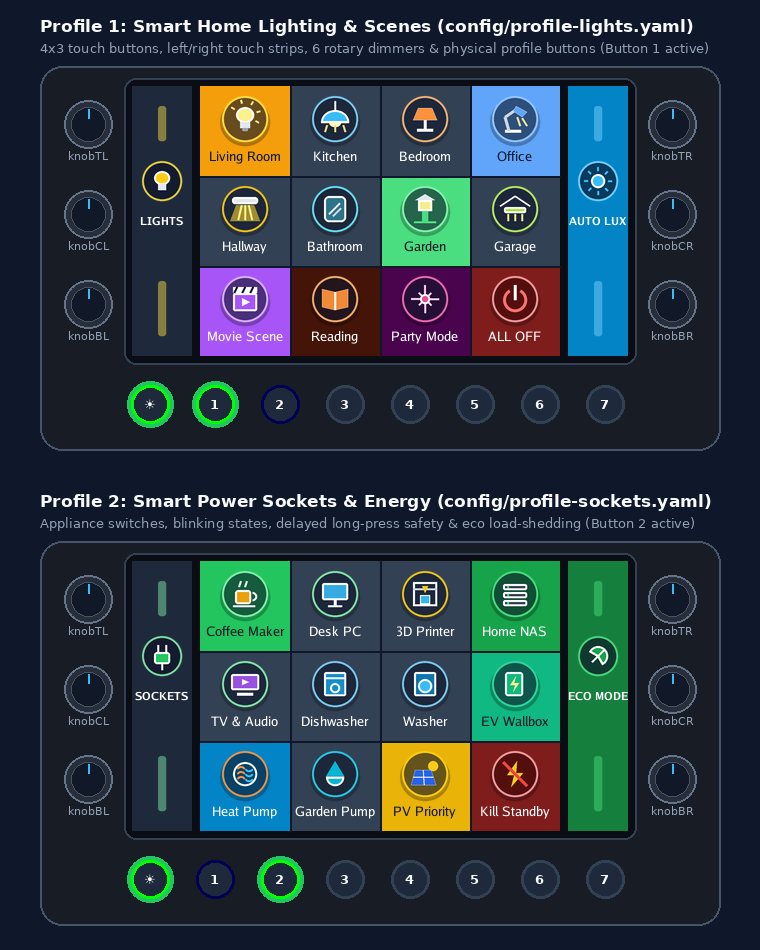

# Loupedeck Commander (Go)

**Loupedeck Commander** (`loupedeck-commander`) is a standalone, zero-CGO Go hardware daemon, interactive Web Emulator & Configuration Studio, and configuration validator for Loupedeck and Razer Stream Controller devices.

---

## Features

- **Hardware Daemon (`run`)**: Direct serial/WebSocket-framed communication with physical Loupedeck & Razer consoles, including automatic USB discovery, hotplug reconnect, RGB565 screen rendering, haptic feedback, and physical button/knob handling.
- **Interactive Web Emulator & Configuration Studio (`emulate`)**: Built-in HTTP/SSE web server with an embedded UI (`pkg/emulator/emulator-ui.html`) for visual profile editing, live or dry-run button/knob/touch testing, OPC UA node simulation, and YAML/JSON export.
- **Configuration Validator & Auto-Fix (`validate`)**: Validates application configs and profile files for schema issues, missing references, and deprecated attributes (`--fix` automatically upgrades legacy profile syntax).
- **Multi-Protocol Interfaces**:
  - **OPC UA** (`github.com/gopcua/opcua`): Monitored item subscriptions, session reuse across profile switches, and read/write calls.
  - **HTTP**: REST/HTTP requests with template interpolation.
  - **Shell**: Sanitized command execution with dry-run simulation support.
- **100% Offline Reproducible Builds**: All Go dependencies are vendored under `./vendor` (`GOPROXY=off`, `GOSUMDB=off`, `CGO_ENABLED=0`).
- **CMake + CMakePresets + Git-Tag Versioning**: Full CMake build, test (`CTest`), and package (`CPack` `.deb`, `.tar.gz`, `.zip`) pipeline driven by `CMakePresets.json` and Git tags.

### Supported Devices

| Model ID  | Device Name               | Grid (`Cols x Rows`) | Side Strips  |
| :-------- | :------------------------ | :------------------: | :----------: |
| `live`    | Loupedeck Live            |       `4 x 3`        | Left & Right |
| `ct`      | Loupedeck CT              |       `4 x 3`        | Left & Right |
| `live-s`  | Loupedeck Live S          |       `5 x 3`        |      —       |
| `razer`   | Razer Stream Controller   |       `4 x 3`        | Left & Right |
| `razer-x` | Razer Stream Controller X |       `5 x 3`        |      —       |

---

## Project Structure

```text
.
├── CMakeLists.txt              # CMake build, CTest, and CPack configuration
├── CMakePresets.json           # Configure, Build, Test, Package, and Workflow presets
├── Makefile                    # Convenience wrapper around CMake presets & Go toolchain
├── build.sh                    # One-step configure + build + CPack script
├── cmake/
│   └── GitVersion.cmake        # Git-tag based version resolver (git describe)
├── cmd/
│   └── loupedeck-commander/    # CLI entrypoint (main.go, main_test.go)
├── config/
│   ├── config.yaml             # Default SmartHome Hub application configuration
│   ├── profile-lights.yaml     # Example profile 1: Smart Home Lighting & Scenes
│   └── profile-sockets.yaml    # Example profile 2: Smart Power Sockets & Energy
├── data/
│   └── icons/                  # 90x90 button icons & 60x270 side-strip PNG graphics
├── doc/
│   └── img/                    # Documentation & sample layout screenshots
├── pkg/
│   ├── commander/              # BaseLoupeDeckHandler, ButtonField, and Button state machine
│   ├── config/                 # Application/Profile config loader, validator & auto-fixer
│   ├── device/                 # Hardware serial protocol, RGB565 2D canvas & emulated device
│   ├── emulator/               # HTTP/SSE Web Emulator & Configuration Studio server
│   └── interfaces/             # OPC UA, HTTP, and Shell interface managers
└── vendor/                     # Vendored Go module dependencies for offline builds
```

---

## CLI Usage

```bash
loupedeck-commander [command] [options]
```

### Commands

| Command    | Description                                                          |
| :--------- | :------------------------------------------------------------------- |
| `run`      | Start the Loupedeck Commander hardware daemon *(default)*            |
| `emulate`  | Start the interactive Web Emulator & Configuration Studio            |
| `validate` | Validate configuration and profile files for errors and deprecations |
| `version`  | Print version, Git tag/commit, Go toolchain, and build timestamp     |
| `help`     | Show CLI usage and options                                           |

### Options

| Option                  | Description                                                                                 |
| :---------------------- | :------------------------------------------------------------------------------------------ |
| `--config=<file>`, `-c` | Application config file (default: `config/config.yaml` or `config/config-<hostname>.yaml`)  |
| `--host=<hostname>`     | Resolve `config/config-<hostname>.yaml`                                                     |
| `--port=<number>`, `-p` | HTTP port for the Web Emulator (default: `3080`)                                            |
| `--live`                | Execute real Shell/HTTP/OPC UA calls in emulator mode (default is safe dry-run)             |
| `--model=<model>`       | Emulated device model: `live` \| `ct` \| `live-s` \| `razer` \| `razer-x` (default: `live`) |
| `--fix`                 | Automatically fix deprecated button attributes & typos during `validate`                    |
| `--version`, `-v`       | Print version information and exit                                                          |
| `--help`, `-h`          | Show help message and exit                                                                  |

### Examples

```bash
# Start hardware daemon using the default SmartHome config (config/config.yaml)
./loupedeck-commander run --config=config/config.yaml

# Launch Web Emulator & Configuration Studio on port 3080 (safe dry-run mode)
./loupedeck-commander emulate --config=config/config.yaml --port=3080

# Validate configuration and auto-fix deprecated profile attributes
./loupedeck-commander validate --config=config/config.yaml --fix

# Print build & Git-tag version metadata
./loupedeck-commander --version
```

### Example Configuration (`config/`)

The repository includes a ready-to-run Smart Home configuration in [`config/config.yaml`](config/config.yaml) with two profiles (switched via physical buttons `1` and `2`):



- **[`config/profile-lights.yaml`](config/profile-lights.yaml) (`lights`)**: Controls room lighting (`Living Room`, `Kitchen`, `Bedroom`, `Office`, `Hallway`, `Bathroom`, `Garden`, `Garage`), lighting scenes (`Movie Scene`, `Reading`, `Party Mode`), a 1s delayed-hold `ALL OFF` master button, `AUTO LUX` daylight toggle on the right touch strip, and 6 rotary dimmers (`knobTL`..`knobBR`).
- **[`config/profile-sockets.yaml`](config/profile-sockets.yaml) (`sockets`)**: Controls smart power outlets (`Coffee Maker`, `Desk PC`, `3D Printer`, `Home NAS`, `TV & Audio`, `Dishwasher`, `Washer`, `EV Wallbox`, `Heat Pump`, `Garden Pump`, `PV Priority`), a 1.5s delayed-hold `Kill Standby` button, `ECO MODE` load-shedding toggle, and rotary controls for EV charge current, heat pump target temperature, and ventilation speed.

---

## Building, Testing & Packaging

### Prerequisites

- **Go** `>= 1.23`
- **CMake** `>= 3.22`
- **Git** (for Git-tag version resolution)
- **Make** or **Ninja**

### Quick Start via `Makefile`

```bash
# Show resolved Git-tag version metadata
make version

# Configure & build default Release binary
make build

# Run unit tests & binary version check via CTest
make test

# Run tests with Go race detector enabled
make test-race

# Cross-compile for Linux (amd64) or Windows (amd64 .exe)
make build-linux
make build-windows

# Generate CPack installers/archives (.deb + .tar.gz)
make package
make package-deb
make package-tgz
make package-windows

# Run full CMake workflow (Configure -> Build -> Test -> CPack)
make workflow

# Clean all build directories and binaries
make clean
```

### Using `CMakePresets.json` Directly

```bash
# List available presets
cmake --list-presets
ctest --list-presets
cpack --list-presets

# Configure, build, test, and package (Release)
cmake --preset release
cmake --build --preset release
ctest --preset release
cpack --preset release

# Or run the complete end-to-end workflow in one command:
cmake --workflow --preset release

# Cross-compile and package for Windows (amd64 .zip):
cmake --workflow --preset windows
```

#### Available Presets

| Preset                | Generator        | Build Dir       | Target OS/Arch       | Packaging (`CPack`)                    |
| :-------------------- | :--------------- | :-------------- | :------------------- | :------------------------------------- |
| `default` / `release` | Unix Makefiles   | `build-RELEASE` | Host (`linux/amd64`) | `DEB`, `TGZ`                           |
| `debug`               | Unix Makefiles   | `build-DEBUG`   | Host                 | `DEB`, `TGZ`                           |
| `race`                | Unix Makefiles   | `build-RACE`    | Host (`-race`)       | —                                      |
| `linux`               | Unix Makefiles   | `build-RELEASE` | `linux/amd64`        | `DEB`, `TGZ`                           |
| `windows`             | Unix Makefiles   | `build-WINDOWS` | `windows/amd64`      | `ZIP`                                  |
| `ninja`               | Ninja            | `build-NINJA`   | Host                 | `DEB`, `TGZ`                           |
| `deb` / `tgz` / `zip` | *(Package-only)* | `build-RELEASE` | Host                 | Single format (`DEB`, `TGZ`, or `ZIP`) |

---

## Git-Tag Versioning Scheme

Version metadata is automatically derived from Git tags by `cmake/GitVersion.cmake` using `git describe --tags --long --dirty --match "v*"` and injected into the Go binary via `-ldflags`:

- **Exact tag (clean working tree)**: `v1.2.3`
- **Exact tag (modified working tree)**: `v1.2.3-dirty`
- **Commits ahead of latest tag**: `v1.2.3-4-g1a2b3c4` (or `v1.2.3-4-g1a2b3c4-dirty`)
- **Untagged repository fallback**: `v0.1.0-0-g<commit>[-dirty]`

CMake writes a `version.stamp` file in the build directory so creating or moving a Git tag automatically triggers relinking of the binary on the next build.

